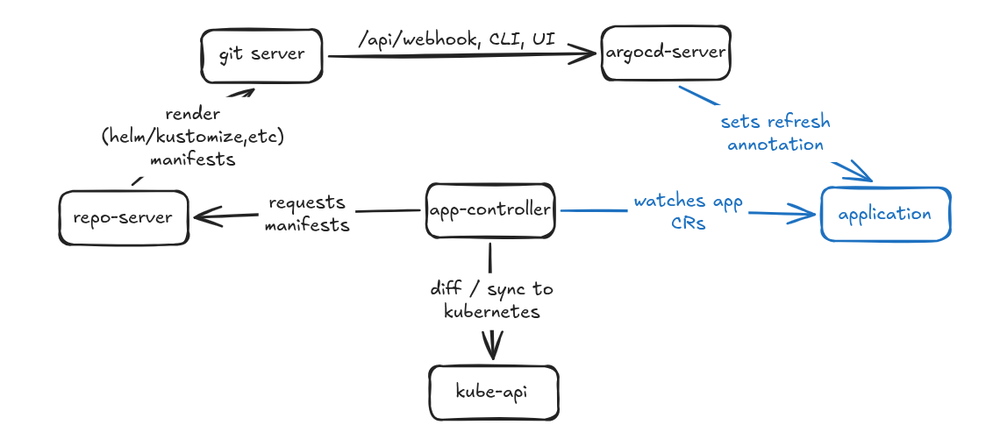

# Architecture

> In your README, include a written or visual architecture explanation covering
what happens end-to-end in the GitOps process when an Argo CD application
watching manifests in Git has an update auto-synced to a cluster. Show how the
following components interact and be prepared to discuss. Note that argocd-server polls the Git repository directly and passes manifest changes to the application-controller.
> - git server
> - argocd-server
> - application-controller
> - repo-server
> - Kube API server

1. The git server (github, etc) receives an update to a repo that ArgoCD is watching
2. if configured, the git server fires off to `/api/webhook`, or ArgoCD polls for repo changes every few minutes 
3. `argocd-server` sets the refresh annotation on the relevant application(s) - [docs](https://argo-cd.readthedocs.io/en/latest/operator-manual/webhook/#application-annotations-used-by-webhooks)
4. `application-controller` watches the `application` custom resources, detects the annotation and requests latest manifests for new git revision
5. `repo-server` pulls latest revision and renders with `helm` and/or `kustomize`, providing them, to the `application-controller`
6. `application-controller` diffs between the desired and cluster state, then applies changes via the `kube API server` 